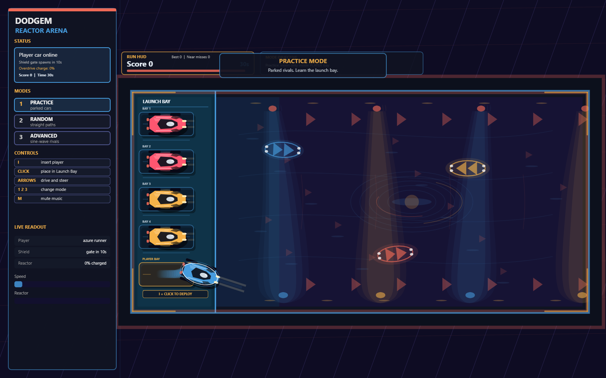

# Dodgem Arena

A browser-based bumper-car game with force-driven controls, rigid-body collisions and an arcade scoring system. Built with JavaScript, p5.js and Matter.js for the Graphics Programming midterm.

## Features

- Three modes: parked practice opponents, straight-moving opponents and sine-wave opponents.
- Four opponents with standard and slower vehicle types.
- Force-based acceleration, reverse and steering inside a bounded arena.
- Boost pads, temporary shields and a collision-powered reactor overdrive.
- Score rings, near-miss rewards, combos and timed runs.
- Collision flashes, vehicle trails, barrier effects, a live HUD and background audio.

## Run locally

Use a desktop browser and serve this directory over HTTP. Python 3 is one option; the application itself has no Python dependency:

```sh
python -m http.server 8000 --bind 127.0.0.1
```

Open [http://localhost:8000](http://localhost:8000). On Windows, `py -m http.server 8000 --bind 127.0.0.1` is equivalent when the Python launcher is installed. There is no npm install or build step; the JavaScript libraries are bundled.

## Controls

| Input | Action |
| --- | --- |
| `1`, `2`, `3` | Select a mode and start a fresh run |
| `I`, then click in the launch bay | Insert the player car; practice mode uses the marked player bay |
| Up / Down arrows | Accelerate / reverse |
| Left / Right arrows | Steer |
| `M` | Mute or unmute the music |

A key press or click activates browser audio. Insertion is rejected when the position overlaps another car. Switch modes to reset the arena after a run.

## Project structure

- `index.html` loads the application and libraries.
- `sketch.js` contains arena setup, physics, controls, scoring and rendering.
- `assets/arena_loop.mp3` supplies the background loop.
- `libraries/` contains p5.js 1.9.0, p5.sound 1.0.1 and Matter.js 0.20.0.

## Scope and limitations

This is a single-player coursework game designed for a keyboard and mouse. Timers use frame counts and the physics advances by a fixed step per draw, so timing can vary on slower devices. The best score is stored only for the current page session. Mobile touch controls and online multiplayer are not implemented.

The portfolio copy passed JavaScript syntax, local asset-reference checks and a basic browser smoke test in headless Microsoft Edge. The browser check covered canvas rendering, all three mode selections, player insertion in practice mode, acceleration, steering and the mute toggle. The audio asset loaded successfully, but playback was not listened to. Full gameplay, scoring and cross-browser behaviour have not been exhaustively tested.

## Credits

Created by Faizan Ilyas as part of the University of London BSc Computer Science programme. Rendering uses [p5.js](https://p5js.org/), audio uses [p5.sound](https://p5js.org/reference/p5.sound/), and physics uses [Matter.js](https://brm.io/matter-js/). Library notices and upstream license texts are retained in `libraries/`. The bundled arena audio came with the project archive; its original source and redistribution terms have not been established. No blanket license is assigned to the project or its assets.

## Preview


